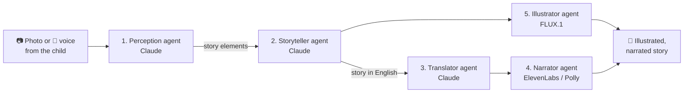

# TinyTales — Backend API

> AI-powered storytelling for kids: a child shows a photo or says a few words, and TinyTales turns it into an illustrated, narrated story adapted to their age and language.

**Capstone project · Computer Engineering Technology · Collège La Cité (2026)**
Backend developed by **Houda Jaoudar**


---

## The problem

Kids spend a lot of time in front of screens, but most of that time is **passive**: they watch, they scroll, they don't create.

## The solution

TinyTales flips that around. The child becomes the author: they **take a photo** of their toy, pet or drawing, or **say out loud** what they want ("a cat that flies with a pink princess"). Five AI agents then work together to build a personalized story, complete with a cover illustration and voice narration, in English, French, Spanish or Arabic.

## How it works: 5 collaborating AI agents



| # | Agent | What it does | Powered by |
|---|-------|--------------|------------|
| 1 | **Perception** | Identifies the main subject in each photo, or extracts the meaningful words from what the child said (handles baby talk, hesitations and mixed languages: *"mon toutou et le jardin"* → `dog, garden`) | Claude (vision + text) |
| 2 | **Storyteller** | Writes an original story around those elements, with length and vocabulary adapted to the child's age (2–3, 4–5, 6–7, 8–9, 10+) and a randomly chosen opening, moral and ending | Claude |
| 3 | **Translator** | Translates the story for a child of that age, keeping the fairy-tale tone ("Il était une fois…", "Había una vez…") | Claude |
| 4 | **Narrator** | Reads the story aloud with **multiple voices** (narrator, male, female, child) and returns speech marks so the app can highlight words as they are read | ElevenLabs, AWS Polly |
| 5 | **Illustrator** | Generates a vintage watercolor-style book cover featuring the story's characters | FLUX.1 (Hugging Face) |

### Built-in fallbacks

Each AI service has a backup, so a story still gets generated if one provider is down:

- **Text:** Claude 3 Haiku on **AWS Bedrock** → falls back to Claude Haiku 4.5 via the **Anthropic API**
- **Voice:** **ElevenLabs** → falls back to **AWS Polly**
- **Images:** **FLUX.1-dev** → falls back to **FLUX.1-schnell**

## Features

- 📷 Story from one or more **photos**
- 🎤 Story from the child's **voice** (spoken phrase or keywords)
- 🎂 **Age-adapted** stories (length, vocabulary, structure)
- 🌍 **4 languages:** English, French, Spanish, Arabic
- 🔊 **Multi-voice narration** with word-level synchronization
- 🎨 AI-generated **cover illustration**
- 👨‍👩‍👧 **Multiple child profiles** per parent account
- ⭐ **Favorites** to save and replay stories
- 🔐 **Authentication:** email + password (Argon2 hashing, JWT), email verification code, password reset by email, Google sign-in, guest mode

## Tech stack

| Layer | Technologies |
|-------|--------------|
| API | Python, FastAPI, Pydantic |
| Database | MongoDB Atlas (Motor async driver) |
| AI: text and vision | Claude via AWS Bedrock and the Anthropic API |
| AI: voice | ElevenLabs, AWS Polly, pydub + ffmpeg for audio merging |
| AI: images | FLUX.1 via the Hugging Face Inference API |
| Security | Argon2 (passlib), JWT (python-jose) |
| Email | Gmail SMTP |
| Mobile app | Flutter *(separate repository: [ADD LINK])* |

## API overview

| Method | Endpoint | Description |
|--------|----------|-------------|
| `POST` | `/register` | Create an account and send a verification code |
| `POST` | `/verify-email` | Verify the email with the 6-digit code |
| `POST` | `/login` | Log in, returns a JWT |
| `POST` | `/google-auth` | Sign in with Google |
| `POST` | `/forgot-password` | Send a reset code by email |
| `POST` | `/reset-password` | Set a new password |
| `GET` `POST` `PUT` `DELETE` | `/profiles` | Manage child profiles |
| `GET` `POST` `DELETE` | `/favorites` | Manage saved stories |
| `POST` | `/generate-story` | Generate a story from photos, voice or keywords |
| `POST` | `/translate-story` | Translate a story (fr, es, ar) |
| `POST` | `/generate-audio` | Generate multi-voice narration + speech marks |
| `POST` | `/generate-cover` | Generate the cover illustration |

Interactive docs are available at `/docs` once the server is running (FastAPI Swagger UI).

## Run it locally

```bash
git clone https://github.com/houdajaoudar/tinytales-backend.git
cd tinytales-backend
python -m venv venv
source venv/bin/activate        # Windows: venv\Scripts\activate
pip install -r requirements.txt
```

Create a `.env` file at the root:

```env
SECRET_KEY=change-me
MONGO_URL=mongodb+srv://...
AWS_ACCESS_KEY_ID=...
AWS_SECRET_ACCESS_KEY=...
ANTHROPIC_API_KEY=...
ELEVENLABS_API_KEY=...
HF_API_KEY=...
GMAIL_USER=...
GMAIL_APP_PASSWORD=...
```

Then start the server:

```bash
uvicorn main:app --reload
```

Open http://localhost:8000/docs to try the endpoints.

## My role

I designed and built this backend:

- the multi-agent AI pipeline (prompts, age adaptation, perception from photos and voice)
- provider fallbacks for text, voice and images
- multi-voice audio generation and synchronization
- authentication and account security (Argon2, JWT, email verification, password reset)
- the MongoDB data model (users, child profiles, favorites)

I also presented the project at the final capstone defense.

## Known limitations and next steps

This is a capstone prototype, not a production app. Before a real launch, I would:

- verify the Google ID token on the server instead of trusting the email sent by the app
- use cryptographically secure verification codes (`secrets`) and limit the number of attempts
- restrict CORS to the app's real origins
- move from `datetime.utcnow()` to timezone-aware datetimes
- add automated tests and split `main.py` into modules (routes, services, models)

---

📫 **Houda Jaoudar** · [LinkedIn](https://www.linkedin.com/in/houda-jaoudar-436804389/) · [GitHub](https://github.com/houdajaoudar)
